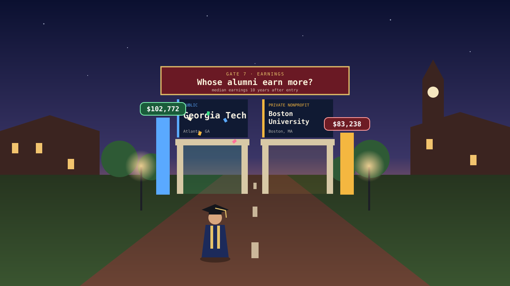

# Cohort

A lane-runner across a college quad at dusk, in Three.js. Every gate is a question from the U.S.
Department of Education's **College Scorecard**: two arches, two schools or two majors, one sign
asking which earns more, costs less, graduates more of its students, leaves less debt, is harder to
get into, or enrols more low-income students. Steer into the arch you believe. Just before you reach
it your lane locks and the real numbers rise out of the ground beside each arch.

It is the gallery's only game, and the only scene whose content is data rather than procedure. Every
figure in it comes from the 19 May 2025 Scorecard release. The fact cards are findings from an
exploratory analysis of the same files.



_The preview is an SVG drawing of the scene, not a screenshot._

## Run it

Needs a static server (ES modules and the import map won't load over `file://`):

```bash
cd animations
python3 -m http.server 8777
# then open http://localhost:8777/college-scorecard-run/
```

Three.js r185 is pulled from unpkg via an import map. There is no build step and no `node_modules`.

## Controls

| Key / input           | Action                                                   |
| --------------------- | -------------------------------------------------------- |
| `←` / `A`             | Steer into the left arch (also starts a run)             |
| `→` / `D`             | Steer into the right arch (also starts a run)            |
| tap / click           | Left or right half of the stage picks that arch          |
| `space` / `P`         | Pause / resume (start, from the title or end screen)      |
| `R`                   | New run with a new seed                                   |
| `H`                   | Hide the side panel; the stage widens to fill the space   |

The **question bar** across the top of the stage repeats the current question in large type, with
the two options under `◀ A` and `D ▶`. Its meter counts down the metres to the lock line, and once
you're locked it shows both real values.

The side panel also holds the run settings:
- **Difficulty:** _Freshman_ pairs differ by at least 45%, _Junior_ by 15–60%, _Grad school_ by only 4–20%.
- **Run length:** 10, 20 or 30 gates.
- **Pace:** _relaxed_ (×0.8), _standard_ or _brisk_ (×1.25) running speed. At standard pace on Junior
  you get about 7.7 s from one gate to the next lock line; on relaxed, about 9.6 s.
- **Topics:** a checkbox for each question type.

Every run can be replayed exactly: the seed is shown in the panel and written to the URL as `?seed=…`.

## Rules

- You have three **credits** (lives). A wrong arch costs one. So does reaching the lock line without
  ever picking a lane ("undeclared").
- A right arch scores `100 × multiplier` plus a pace bonus. The multiplier goes up by one for every
  three correct answers in a row.
- Pace rises a little with every gate.
- Clear every gate and you graduate. Your honour (summa, magna or cum laude) depends on your accuracy.
- Best score is kept in `localStorage`.

## The data

| Set        | Source file                                   | What's in the game                                                     |
| ---------- | --------------------------------------------- | ---------------------------------------------------------------------- |
| `SCHOOLS`  | `Most-Recent-Cohorts-Institution.csv`         | 109 operating schools: the largest in each sector, the top 25 by earnings, and well-known names |
| `PROGRAMS` | `Most-Recent-Cohorts-Field-of-Study.csv`      | 78 Georgia Tech and UC Berkeley programs with ≥ 30 completers          |
| `FACTS`    | Exploratory analysis of the same release      | 18 "did you know" cards, such as sector gaps, correlations and the two campuses' trends |

The columns used:

| Question type | Column       | Meaning                                        |
| ------------- | ------------ | ---------------------------------------------- |
| Earnings      | `MD_EARN_WNE_P10` | Median earnings 10 years after entry      |
| Net price     | `NPT4_PUB` / `NPT4_PRIV` | Average annual net price after aid |
| Completion    | `C150_4` (or `C150_L4`) | Completion within 150% of normal time |
| Debt          | `GRAD_DEBT_MDN` | Median debt at graduation                   |
| Selectivity   | `ADM_RATE`   | Admission rate                                 |
| Access        | `PCTPELL`    | Share of undergraduates on Pell grants         |
| Programs      | `EARN_MDN_4YR` | Median earnings 4 years after completing     |

Earnings and debt cover only students who received federal aid. Dollars are nominal.

## What's in the scene

| File             | Contents                                                                              |
| ---------------- | ------------------------------------------------------------------------------------- |
| `src/main.js`    | Renderer, game state machine, gate spawning and resolving, input, camera, side panel  |
| `src/data.js`    | The Scorecard extract, the fact cards, metric definitions and the question generator  |
| `src/gates.js`   | Arches, pennants, question sign, data columns and the reveal                          |
| `src/campus.js`  | Sky dome, stars, lawn and brick walk, recycled scenery segments, lights               |
| `src/runner.js`  | The graduate: gown, mortarboard, tassel pendulum and the procedural run cycle         |
| `src/fx.js`      | Pooled InstancedMesh confetti                                                         |
| `src/labels.js`  | CanvasTexture drawing for pennants, signs and value tags                              |
| `src/rng.js`     | Seeded PRNG (mulberry32)                                                              |

### Design notes

- **The lock line is drawn, not implied.** 15 m before each arch there is a gold light curtain
  reading `▼ ANSWER LOCKS ▼`, a hazard strip across the path and a glowing pylon at each edge. All
  three pulse faster as you approach. Between the line and the arch, rails mark each lane and a
  divider separates them. On the lock the curtain flares and lifts away, the chosen lane's rails
  turn solid gold, and the other lane's rails, veil and divider turn red. A key press after the
  line shakes the meter in the question bar, so a refused input is visible.
- **Reading time comes first.** Gates are 96 m apart (they were 66 m), the base pace is about 15%
  slower, and the speed cap is 17 m/s (it was 24 m/s). The question appears in the bar the moment
  the previous arch is passed. The in-world text was enlarged too: names on the pennants are drawn
  at 84–150 px with a dark outline, and the question sign is 40% taller and tipped toward the camera.
- **The reveal happens before the arch, not after it.** A lane-runner's camera looks forward, so a
  result shown at the moment of passing plays out behind the player. The lane locks 15 m before the
  arch, and the columns spend the next second rising, so the answer arrives while you are still
  running at it.
- **The columns are honest bars.** On "which costs less?" the right answer is the shorter column.
  Height always means the value, and the tag on top shows right or wrong in green or red.
  Flipping heights to make "good" always tall would teach the wrong picture of the data.
- **Pairs are drawn by ratio, not by rank.** Difficulty is the ratio between the two values, so a hard
  gate is a genuinely close call (4–20%) but never a coin flip. Every topic has hundreds of
  valid pairs in every band. A short window of recently used schools stops the same name from
  coming round three gates in a row.
- **The right answer's side is random.** It is decided after the pair is drawn, so lane position
  carries no information.
- **The panel never covers the stage.** All controls and readouts live in a 320 px sidebar beside
  the canvas, or below it on narrow screens. The question bar is a separate strip above the canvas,
  not an overlay; the canvas resizes to the space left beneath it. The only things ever drawn over the stage are the
  title and end menus, and neither is up during play. The camera widens its lens on a tall stage
  so both arches stay in frame.
- **The ground moves with the runner and its texture scrolls back to cancel the motion.** A flat
  plane maps texture v to world −z, so the offset that pins the pattern to the world is
  `−z · repeat / size`. Getting the sign wrong makes the lawn slide past at double speed.
- **Scenery is a ring of seven segments that leapfrog**, so a run of any length allocates nothing
  after start-up. Gates are the only per-run objects. Each one owns its textures and materials and
  disposes them once it falls 40 m behind.
- **The lateral spring keeps working while the lane is locked.** The lock refuses new choices but
  does not stop the move already in progress. Stopping the move too left a late swerve frozen
  between lanes, which ran the graduate into a stone post.
- **Pennants and signs are unlit and unfogged** (`MeshBasicMaterial`, `fog: false`,
  `toneMapped: false`). They have to be readable from 70 m away at dusk, which a lit, fogged material
  at that distance is not.

### Skills referenced

- `threejs-fundamentals`: renderer, camera, `Timer`, `ResizeObserver` resize, `Object3D` hierarchy, disposal.
- `threejs-geometry`: `LatheGeometry` gown, primitive kit-bashing, `InstancedMesh` confetti.
- `threejs-materials`: `MeshStandardMaterial`, `MeshLambertMaterial`, `MeshBasicMaterial`, `ShaderMaterial` sky.
- `threejs-textures`: `CanvasTexture`, sRGB colour space, repeat-wrapped scrolling.
- `threejs-lighting`: hemisphere fill, plus a shadow-casting key light that follows the runner.
- `threejs-animation`: procedural run cycle, damped springs, eased reveals.
- `threejs-interaction`: keyboard input, pointer halves of the stage.

### Verified

- **Question generator:** checked against the extract offline. Every topic has at least 445 valid
  pairs in every difficulty band, so a 30-gate run cannot run out of questions.
- **Not yet checked:** a browser frame-rate measurement, as recorded for the other scenes.
