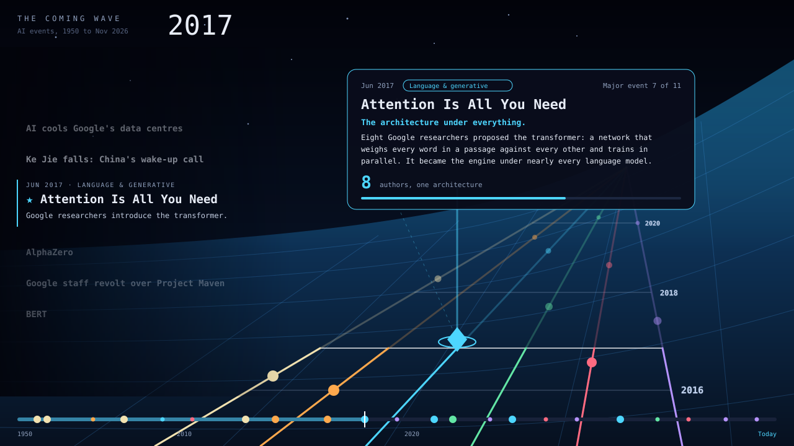

# Groundswell

A timeline of artificial intelligence from 1950 to 11 November 2026, ridden as a wave, in Three.js.
It follows the AI story in Mustafa Suleyman's _The Coming Wave_ (2023) and carries it on to today.
Six coloured threads run along an ocean that swells as the years go by and rears up into a wall
just past the present.

Events come in two kinds. **Minor** events scroll up the left of the stage like song lyrics, one
line at a time. **Major** events are breakthroughs in technique: each one grows a story card out of
its marker, unfolds a short telling of what happened, and holds the timeline for five seconds.

Like Cohort, this is a scene whose content is data rather than procedure. Unlike Cohort, the data is
an editorial selection, not a published dataset. Read [The data](#the-data) before quoting from it.



_The preview is an SVG drawing of the scene, not a screenshot._

## Run it

Needs a static server (ES modules and the import map won't load over `file://`):

```bash
cd animations
python3 -m http.server 8777
# then open http://localhost:8777/coming-wave-ai-timeline/
```

Three.js r185 is pulled from unpkg via an import map. There is no build step and no `node_modules`.
Playback starts by itself and takes about 3.4 minutes at 1x: 152 s of travel plus eleven 5 s pauses.

## Controls

| Key / input      | Action                                                        |
| ---------------- | ------------------------------------------------------------- |
| `space`          | Play / pause. With a story card open, it holds the card       |
| `←` / `→`        | Previous / next event                                         |
| `R`              | Restart from 1950                                             |
| `H`              | Hide the side panel; the stage widens to fill the space       |
| click a line     | Jump to that event (a major event opens its card)             |
| click an axis dot | Jump to that event; drag along the axis to scrub             |
| click a 3D marker | Jump to that event; hover shows its date and title           |

The side panel also holds:

- **Playback:** play / pause, restart, previous, next.
- **Pace:** speed (0.5x to 3x), the length of the story pause (2 to 15 s), a switch for pausing on
  major events at all, and a switch for the event list.
- **Threads:** a checkbox per thread. Switching one off removes its ribbon, markers, list lines and
  axis dots, and re-times the run for what is left.
- **Major events:** the eleven cards, as a jump list.

The `×` in the panel's corner does the same as `H`. With the panel hidden, a small `Controls` button
in the corner of the stage brings it back.

## The data

`src/data.js` holds 86 events on six threads.

| Thread                | Events | Major |
| --------------------- | -----: | ----: |
| Foundations           |     13 |     4 |
| Games & agents        |     11 |     2 |
| Language & generative |     20 |     4 |
| Science & real world  |      9 |     1 |
| Power & geopolitics   |     13 |     0 |
| Risk & containment    |     20 |     0 |

| Era         | Events | Major | Share of the route |
| ----------- | -----: | ----: | -----------------: |
| 1950–2009   |     15 |     3 |                22% |
| 2010–2019   |     19 |     4 |                30% |
| 2020–2026   |     52 |     4 |                48% |

The eleven major events: Dartmouth (1956), the Perceptron (1958), backpropagation (1986), AlexNet
(2012), DQN and Breakout (2013), AlphaGo's move 37 (2016), the transformer (2017), GPT-3 (2020),
AlphaFold (2020), diffusion models (2022) and reasoning models (2024).

What to know before relying on it:

- **Events and dates up to 2025 were written from memory**, of the book and of the field. They were
  not looked up, and not checked line by line against the book's text.
- **The nine 2026 events come from a web search** made on 11 Nov 2026. Three of them rest on a
  single site each (the Anthropic funding round, the Safety Report date and the UK lab). The UK
  lab's day of the month is a placeholder; only the month is shown.
- **Book events and wider context are mixed without flags.** The book was published in September 2023, so
  everything after that is context, as are most of the events before 2010.
- **The "In the book" notes are paraphrases** of Suleyman's argument, not quotations. Cards whose
  subject the book does not cover in any depth say "Link to the book" instead.
- **Headline numbers on the cards are from memory** too, including o1's 83% against 13%.
- **No major card after September 2024**, because no later technique breakthrough was researched.

Sources for the 2026 entries:

| Event                                   | Source                                                                             |
| --------------------------------------- | ---------------------------------------------------------------------------------- |
| International AI Safety Report 2026     | https://timeline.the-blueprint.ai/                                                 |
| A $30 billion funding round             | https://aiunpacking.com/guides/ai-news-2026-timeline-major-developments/           |
| India AI Impact Summit                  | https://en.wikipedia.org/wiki/2026_in_artificial_intelligence                      |
| Claude Mythos is held back              | https://en.wikipedia.org/wiki/Claude_Mythos                                        |
| Claude Fable 5                          | https://en.wikipedia.org/wiki/Claude_Mythos                                        |
| An AI agent breaks out                  | https://en.wikipedia.org/wiki/OpenAI%E2%80%93HuggingFace_incident                  |
| Pacing the Frontier                     | https://thenextweb.com/news/pacing-the-frontier-ai-employees-letter-us-government  |
| EU transparency rules apply             | https://en.wikipedia.org/wiki/2026_in_artificial_intelligence                      |
| UK AI Biosecurity Lab                   | https://timeline.the-blueprint.ai/                                                 |

To change the timeline, edit `src/data.js`: an event needs `id`, `date`, `thread`, `tier`, `title`
and `line`; a major one adds `kicker`, `story`, `stat`, `statLabel` and `book`. To move "today",
change `TODAY` and the last knot of `AXIS`.

## What's in the scene

| File              | Contents                                                                                     |
| ----------------- | -------------------------------------------------------------------------------------------- |
| `src/main.js`     | Playback state machine, story-card pause, input, layout, frame loop, cleanup                 |
| `src/data.js`     | The threads, the axis knots and the 86 events                                                |
| `src/timeline.js` | The hybrid time axis and the playback schedule; no DOM and no Three.js                       |
| `src/overlay.js`  | The HTML: lyric list, story card, time axis, and the lists in the side panel                 |
| `src/world.js`    | Renderer, scene assembly, camera rig, view shift, picking, projection, disposal              |
| `src/ocean.js`    | The swell (the one height function), the camera-following water grid, the star dome          |
| `src/lanes.js`    | Thread ribbons, year gates with `CanvasTexture` labels, the white "now" line                 |
| `src/markers.js`  | Event markers: spheres for minor events; gem, ring and beam for major ones                   |
| `src/rng.js`      | Seeded PRNG (mulberry32), used for the stars                                                 |

### Design notes

- **The time axis is hybrid.** It is piecewise linear with knots at 1950, 2010, 2020 and today.
  Sixty quiet years get 22% of the route and the last seven get 48%. On a true scale, 52 of the 86
  events would be packed into the last 9% of the ride.
- **Pacing is by distance, then clamped.** The gap between two events is their distance on the axis
  at 45 s per route, held between 1.7 s and 3.4 s. Sparse decades do not drag, and a line is never
  on screen for less than it takes to read.
- **A story card stops the timeline, not the sea.** The playback clock halts while a card is open.
  The swell runs on a separate clock that never stops, and the camera drifts in on the marker.
- **The card grows out of its marker.** `world.project()` gives the marker's place on the stage. The
  card starts there at 12% scale, travels to the centre, and only then unfolds its story, using a
  grid row that goes from `0fr` to `1fr`. If the marker is off screen, it grows from the axis dot.
- **The card has no buttons.** It closes itself when the countdown bar runs out. `space` holds it,
  and the pause length is a slider in the panel.
- **One height function seats everything.** The water, ribbons, year gates and markers all sample
  `swell.height(x, z, t)`, so nothing floats or sinks as the wave passes under it.
- **The water is one grid that follows the camera.** About 7,900 vertices have their heights and
  colours recomputed on the CPU each frame. The grid snaps to its own pitch, so the vertices do not
  swim. A vertex shader would be cheaper; the CPU version was kept because the same function has to
  seat the markers and ribbons anyway.
- **Each ribbon is two meshes on one buffer.** A dim one runs the whole route. A lit one is revealed
  with a draw range from the thread's first event up to "now", so a thread visibly begins.
- **Everything is unlit and there is no tone mapping.** `MeshBasicMaterial` throughout means a
  thread's colour on the water is the same colour as its chip in the panel and its dot on the axis.
- **The view is shifted, not the camera.** With the event list showing, `setViewOffset` moves the
  picture 13% to the right, which keeps the "now" line clear of the list without changing the
  perspective.
- **The panel never covers the stage.** It is a 320 px column beside the canvas, or below it on
  narrow screens. The list, the card and the axis are drawn over the scene on purpose: they are the
  visualization, not its controls.
- **The timeline works without the 3D scene.** `main.js` imports no Three.js. It loads `world.js`
  with a dynamic import, and if that fails (no WebGL, or the CDN is unreachable) the list, cards and
  axis still play under a short notice. This is why the loop is a plain `requestAnimationFrame`
  rather than `renderer.setAnimationLoop`, unlike the other scenes.
- **The stars are seeded with a fixed seed**, so every load draws the same sky. There is no `?seed=`
  parameter: nothing else in the scene is random.
- `prefers-reduced-motion` slows the swell to 35% and removes the CSS transitions. The timeline
  itself still plays.

### Skills referenced

- `threejs-fundamentals`: renderer, camera, `ResizeObserver` resize, `setViewOffset`, disposal.
- `threejs-geometry`: per-frame `BufferGeometry` updates, a shared attribute, draw ranges, shared marker geometry.
- `threejs-materials`: unlit `MeshBasicMaterial`, vertex colours, wireframe overlay with `polygonOffset`, additive beams.
- `threejs-textures`: `CanvasTexture` year labels in sRGB.
- `threejs-animation`: procedural swell, frame-rate-independent camera damping, marker pulses.
- `threejs-interaction`: `Raycaster` picking, keyboard input, pointer scrubbing on the axis.

### Verified

- **Page, playback and layout:** `index.html`, `main.js`, `overlay.js` and `timeline.js` were run in
  headless Chromium at 1280×720 and 700×900, with a stand-in for `world.js` and a ten-event sample
  dataset. 57 of 59 checks passed, covering autoplay, the 5 s card pause (measured), `space` holding
  a card, the panel closing and reopening, card and panel never overlapping, thread toggles,
  scrubbing, replay, and the no-WebGL fallback. The two failures were faults in the test, each
  confirmed separately: a missing favicon logged as an error, and a string comparison.
- **Timing core:** 11 Node checks on `timeline.js`, including the axis and the schedule round-trips.
- **3D modules:** `world.js`, `ocean.js`, `lanes.js`, `markers.js` and `rng.js` ran 320 simulated
  frames against a stand-in for the Three.js API, with 22 checks on finite buffers, draw ranges,
  picking, resize and disposal. This catches wiring and arithmetic mistakes, not rendering ones.
- **Files:** every source file here matches its tested copy by SHA-256, and `data.js` matches the
  dataset it was generated from.
- **Not yet checked:** the scene has not been run against the real Three.js r185 or drawn by a GPU,
  so how the wave looks is unverified. The full 86-event dataset has not been played through in a
  browser, and no frame rate has been measured, as recorded for the other scenes.
