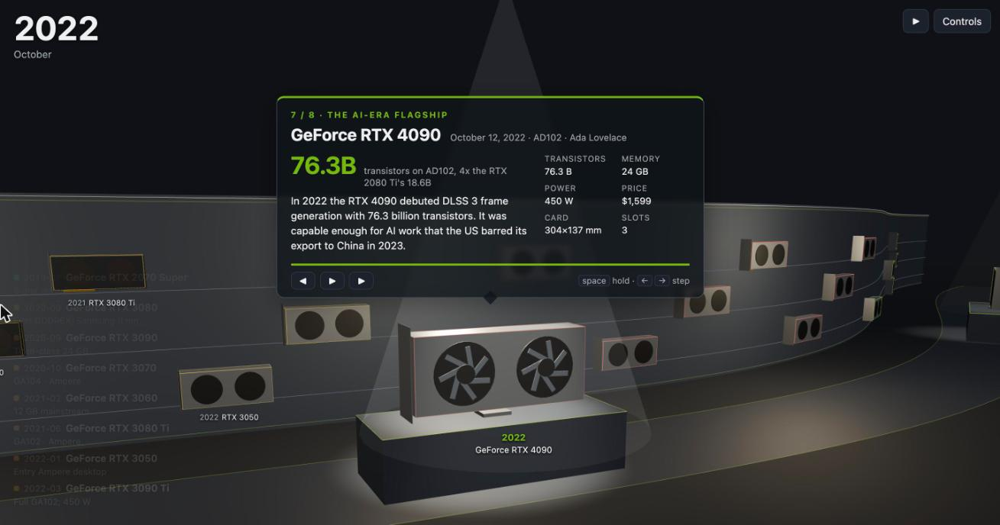

# GeForce Gallery

Thirty years of NVIDIA consumer GPUs as a gallery walk, in Three.js. The camera follows a curved path
through a lit hall. Nine milestone cards stand on spotlit plinths at their true size, from the NV1 (1995)
to the RTX 5090 (2025). The other 79 consumer GPUs hang on the wall behind them, and a short list centred
below the wall names the one being passed. At each milestone the walk pauses and a see-through story card pops up out of the GPU,
anchored just above it like a pop-up menu, with an arrow pointing at the card. The page reads in English or Chinese (简体中文); the Chinese title is GeForce 陈列馆.

It is the consumer lane of [Tapeout](../nvidia-gpu-skyline/) given a scene of its own. The data-center
lane became [The AI Factory](../nvidia-datacenter-skyline/). The milestone rows were checked again for this
scene; the rest were not. Read [The data](#the-data) before quoting from it.



_The preview is a screenshot of the RTX 4090 milestone in Chrome, with the panel hidden and the pop-up story
card at 80% opacity._

## Run it

It needs a static server, because ES modules and the import map won't load over `file://`. From the
repository root:

```bash
python3 -m http.server 8777
# then open http://localhost:8777/nvidia-consumer-gallery/
# or      http://localhost:8777/nvidia-consumer-gallery/?lang=zh   for Chinese
```

Three.js r185 is pulled from unpkg via an import map. There is no build step and no `node_modules`.
The same import map pins every module under `src/` to a version (`?v=…`). **If you edit anything in `src/`,
bump that version in `index.html`**: in the import map and on the `main.js` script tag. Otherwise a
browser can pair a fresh `index.html` with stale cached scripts. `http.server` and GitHub Pages send no
long-lived cache headers, so browsers guess, and Chrome's normal reload can reuse cached scripts. This
happened once during the build: the new page with the old `main.js` left the story card in the top-left
corner.
Playback starts by itself, after a title frame ("1995 – 2025 · NVIDIA's 88 consumer (gaming) GPUs") that
holds for about 4 s over the darkened hall and then eases out; it returns on Restart, `space` holds it, and
stepping to a milestone skips it. At 1× the walk takes about 61 s of travel plus a 7 s pause at each of the nine
milestones, about 2 min 4 s in all.

## Controls

| Key / input             | Action                                                             |
| ----------------------- | ------------------------------------------------------------------ |
| `space`                 | Play / pause. With a story card open, it holds the card             |
| `←` / `→`               | Previous / next milestone                                          |
| `R`                     | Restart from 1995                                                  |
| `H`                     | Hide the side panel; the stage widens to fill the space            |
| hover a card            | Its specs, note and check status (any card, plinth or wall)        |
| tap a card (touch)      | The same tooltip, for 3.5 s                                        |
| click / tap a milestone | Jump to it and open its story card                                 |

The story card holds only the story: every control lives in the side panel. On a phone the panel starts
hidden and opens from the `Controls` button, next to a play / pause button. The side panel holds:

- **Language:** `EN` / `中文`. It switches in place, keeping the camera, the playback position and any open
  card. The choice is kept in `localStorage` (`geforce-gallery-lang`) and written to the URL as `?lang=`.
- **Playback:** play / pause, previous, next and restart. There is also a speed slider (0.5× to 3×) and
  the story pause (3 to 15 s, 7 s by default).
- **Story card opacity:** 40% to 100%, 80% by default, kept in `localStorage` (`geforce-gallery-card-opacity`).
- **Milestones:** the nine cards as a jump list.

The `×` in the panel's corner does the same as `H`. With the panel hidden, a play button and a
`Controls` button sit in the corner of the stage.

### Screen sizes

The layout is re-checked on every resize, so rotating a phone or closing the panel can switch it.

| Layout              | When                                          | Panel                            | Story card                                         |
| ------------------- | --------------------------------------------- | -------------------------------- | -------------------------------------------------- |
| Desktop             | otherwise                                     | 300 px column on the right       | pop-up above the GPU, up to 560 px wide; story left, specs right |
| Narrow (portrait)   | stage under 760 px wide, or taller than wide  | sheet below the stage, starts hidden | pop-up above the GPU, 80% of the stage width; the year counter hides |
| Short (landscape)   | wider than tall but under 500 px high         | 270 px column, starts hidden     | pop-up to the GPU's right (arrow pointing left), below the stage buttons |

On narrow and short stages the list keeps its five rows with smaller type, and the camera widens its field of
view. On phones the camera also slides the picture sideways so the milestone GPU is centred (the three-quarter
view would otherwise leave it off to one side), and the story card is centred on the stage with its arrow
still pointing at the GPU. Its distance is fitted to the stage width, so a whole card stays in frame on a 390 px phone.

## The data

`src/data.js` holds the 88 consumer rows of `../nvidia-gpu-skyline/src/data.js` in release order, and
the 16 architecture colours they use. The nine milestone rows carry the values from a fresh check made in
November 2026 (the GTX Titan was added later the same month). The other 79 rows are Tapeout's.

| Check status | Rows | Which                                                                  |
| ------------ | ---: | ---------------------------------------------------------------------- |
| Verified     |   41 | the 9 milestones, and 32 minor rows Tapeout had verified                |
| Corrected    |    9 | minor rows Tapeout corrected                                           |
| Partial      |    7 | minor rows resting partly on spec aggregators                          |
| Unverified   |   31 | minor rows written from memory for Tapeout and not yet checked         |

The hover tooltip shows each row's status in its own colour.

### The milestones

| # | GPU                | Date         | Board drawn                              | Size (mm)   | Slots | Cooler            |
| - | ------------------ | ------------ | ---------------------------------------- | ----------- | ----: | ----------------- |
| 1 | NV1                | 1995-05-22   | Diamond Edge 3D 2120XL                   | 191 × 107 ¹ |     1 | none              |
| 2 | RIVA 128           | 1997-08-25   | STB Velocity 128                         | 175 × 107 ¹ |     1 | passive heatsink  |
| 3 | GeForce 256        | 1999-10-11   | Creative 3D Blaster Annihilator          | 190 × 107 ¹ |     1 | small fan         |
| 4 | GeForce 3          | 2001-02-27   | ELSA Gladiac 920                         | 173 × 108   |     1 | small fan         |
| 5 | GeForce 8800 GTX   | 2006-11-08   | NVIDIA reference board                   | 270 × 111 ¹ |     2 | blower            |
| 6 | GeForce GTX Titan  | 2013-02-21   | NVIDIA reference design                  | 267 × 111   |     2 | silver blower with a window |
| 7 | GeForce RTX 2080 Ti| 2018-09-27   | Founders Edition                         | 267 × 116   |     2 | two axial fans    |
| 8 | GeForce RTX 4090   | 2022-10-12   | Founders Edition                         | 304 × 137   |     3 | flow-through      |
| 9 | GeForce RTX 5090   | 2025-01-30   | Founders Edition                         | 304 × 137   |     2 | double flow-through |

¹ An estimate. For the NV1, RIVA 128 and GeForce 256 the length comes from weak sources or the standard
length of the era, and the height is the standard full height. For the 8800 GTX the length is sourced and
the height is estimated. The hover tooltip marks these four "size estimated"; the story card doesn't repeat it.

Values changed against Tapeout:

| GPU          | Change                                                                       |
| ------------ | ---------------------------------------------------------------------------- |
| NV1          | Transistors — → 1 M; memory — → 1 MB; launch price — → $249                  |
| RIVA 128     | Transistors 4 M → 3.5 M; price — → about $200 (a partner board's street price) |
| GeForce 3    | Status partial → verified; no value changed                                  |
| GTX Titan    | Date 2013-02-19 → 2013-02-21 (19th announced, 21st launch reviews, retail 25th) |
| RTX 2080 Ti  | Date 2018-09-20 → 2018-09-27 (the Ti shipped a week after the RTX 2080)       |
| RTX 4090     | Die 608 → 608.5 mm²                                                          |

The story text was reworded where a claim in the original brief went further than the sources:

- **RIVA 128:** no source supports "the first to support full DirectX". The card says it was "built around
  Microsoft's Direct3D". "More than one million in four months" became "about a million".
- **GeForce 256:** NVIDIA *marketed* it as the "world's first GPU". 3Dlabs had used the term in 1997.
- **8800 GTX:** the first CUDA GPU. CUDA was announced at its launch in November 2006, and the public SDK
  followed in February 2007.
- **GTX Titan:** it is *not* "the beginning of high-end consumer GPUs": the 8800 Ultra ($829) and the
  dual-GPU GTX 690 ($999) came first. It was the first *single-GPU* GeForce at $999, with the GK110 chip of
  the Tesla K20X cards in Oak Ridge's Titan supercomputer. Its 1.3 TFLOPS double precision is NVIDIA's
  figure; the K20X is rated 1.31 TFLOPS. Deep-learning use is a later Titan X story, so its card doesn't
  claim it.
- **RTX 20:** it "brought RT Cores to gaming". The Quadro RTX workstation cards had them a week earlier.
- **RTX 4090:** the AI angle rests on the US export ban to China (October 2023). Only hobbyist and
  benchmark sites call it a local-AI card.
- **RTX 5090:** it runs quantized models of about 30 B parameters, not 70 B ones.

What to know before relying on it:

- **TechPowerUp, TechSpot, AnandTech and vgamuseum refused direct page reads** during the check, so
  figures from them came from search-result excerpts. NVIDIA's pages and Wikipedia were read directly.
  NVIDIA's original 1999 GeForce 256 press release could not be read, because web.archive.org was blocked.
- **Dates are launch dates.** The NV1 is the exception: May 1995 is when it was announced, and cards
  reached shops around November. Each hero row keeps its announcement date in `hero.announced`.
- **The minor GPUs are drawn in an era-typical size**, not their own. The sizes by year are: before 1999,
  175 × 107 mm with a heatsink. 1999–2003, the same with a small fan. 2004–2017, 267 × 111 mm, two slots,
  blower. 2018–2021, 267 × 116 mm, two axial fans. 2022 on, 304 × 137 mm, three slots. Tapeout has no
  dimensions, and the tooltip says "size era-typical".
- **The card models are sketches of the form factor.** They are boxes and discs at the right size with
  the right kind of cooler, not replicas of any board.
- **The RTX 5090 card's headline is its 21,760 CUDA cores (170× the 8800 GTX's 128)**, not NVIDIA's
  3,352 "AI TOPS". That figure is counted at 4-bit (FP4) precision, and set against the RTX 4090's 1,321
  it would overstate the jump.
- **The Chinese text was machine-written and has not been reviewed by a native reader.** That covers
  `src/i18n.js` (the panel, tooltips and formats), the `labelZh` / `storyZh` milestone copy, and every
  `noteZh`. All 79 minor rows now carry a Chinese note; before this pass, 12 of them had none in either
  language and fell back to a chip name.
- **The minor-row notes are spec-derived.** For the 12 rows that had no note (RTX 2070 through RTX 5060),
  the note restates the row's own die, memory and power figures, and says whether the die is a cut-down
  or shared one. Nothing was added beyond what the row already records; those rows keep their
  `unverified` / `partial` status.
- **Chinese sets numerals and nouns together.** Transistor counts read 763 亿晶体管 rather than
  763 亿 晶体管, and card width reads 双槽 rather than a bare 2. 万 / 亿 follow Tapeout's convention.

Each hero row carries the pages used in its check in `hero.sources`.

## What's in the scene

| File            | Contents                                                                                     |
| --------------- | -------------------------------------------------------------------------------------------- |
| `index.html`    | Markup, all CSS (three layouts), the import map                                              |
| `src/main.js`   | State, panel, story card, list, tooltip, input, layout mode, frame loop. Imports no Three.js  |
| `src/world.js`  | Renderer, the hall and its lights, plinths, the wall of minor GPUs, camera rig, picking       |
| `src/cards.js`  | The graphics-card model factory: board, bracket, gold fingers and seven kinds of cooler       |
| `src/layout.js` | The path, where every GPU sits on it, chapter timing, the calendar, board sizes. No DOM, no Three.js |
| `src/i18n.js`   | Every string in English and Chinese, and the date, number and unit formats                   |
| `src/data.js`   | The 88 GPUs and the architecture colours                                                     |

### Design notes

- **Each milestone gets the same length of path.** On a true time scale, four milestones would crowd into
  1995–2001 and twelve empty-feeling years would sit between the 8800 GTX and the RTX 20. Here each chapter
  is 24 units long, and its minor GPUs are spread evenly inside it. The year counter interpolates between
  real release dates, so it speeds up and slows down instead.
- **Travel time grows with a chapter's size:** 4 s plus 0.32 s per minor GPU, capped at 16 s at 1×. The
  2006–2013 and 2013–2018 chapters have 19 minor GPUs each and take about 10 s; the 1995–1997 chapter has
  none and takes 4 s. That keeps the list readable. Before the GTX Titan was added, 2006–2018 was one
  chapter of 39 GPUs at the 16 s cap.
- **True size is the point.** A card's length and height are its measured millimetres (1 unit = 10 cm),
  and its thickness is its slot count × 20.32 mm. The outline grows only 1.7× in thirty years, from 175 to
  304 mm; the cooler does the growing. The camera looks at each card in three-quarter view so the
  thickness shows. The RTX 5090 is visibly thinner than the RTX 4090.
- **The story card is a pop-up anchored to the GPU.** Every frame, `world.heroBox()` projects the focused
  card's bounding box to the screen. `main.js` places the story card 14 px above its top edge, centred on it,
  with a small arrow on the card's edge pointing down at the GPU. It follows the GPU while the camera eases
  in. It is kept 8 px inside the stage; if there is not enough room above, it overlaps the GPU rather than
  leave the stage. Landscape phones have no room above, so there it sits to the GPU's right with the arrow
  pointing left.
- **The camera makes room for it.** While a card is open, the camera's view offset shifts the picture down
  by half the card's height, and the camera pulls back a little, so the GPU lands below the card.
- **The card pops up out of the arrow's tip.** It scales from 6% with its transform origin at the arrow and
  settles in 0.6 s with a small overshoot; the arrow fades in last. With `prefers-reduced-motion` it simply
  appears.
- **The card is see-through by design**, with a light blur. Its opacity slider runs from 40% to 100%, so
  the plinth, spotlight and wall stay readable behind it.
- **The hall is lit to be read.** It has a hemisphere fill, a warm key light from the visitor's side, and
  three warm point lights that travel with the camera to wash the stretch of wall in view. Each plinth has
  a spotlight with a faint additive cone that comes up as the camera arrives. An earlier, darker draft hid
  the wall cards; this is the result of that feedback.
- **The walk stays close to the wall.** Between milestones the camera runs 6.6 units from the wall (6.2 on
  narrow stages), aimed a little below the middle row so all three rows sit clear of the list. A warm
  spotlight picks out the card being passed: the last one reached, which is also the newest line in the
  list. The light jumps to each new card and fades in rather than sliding across the wall. It switches off
  within 3 units of a milestone, where the milestone view takes over. The wall cards are hung at 55% scale,
  so even this close they read smaller on screen than the milestone cards.
- **Names are read from a still list, not from the wall.** An earlier version put a name label under each
  wall card. The labels moved with the camera and were hard to read, so they are hidden during the walk.
  Instead the list sits in the centre of the stage, on a soft dark backing, as a five-row window onto a
  strip of all 79 minor GPUs. The card being passed (the one in the spotlight) is always the middle, third
  row, set larger and fully bright, with the two before it above and the next two below; the outer rows
  dim and the window fades at its top and bottom edges. Each row has the name and its note, on desktop and
  phones alike. Moving on to the next GPU slides the strip by one row with an eased 0.7 s transition (it
  scrolls, rather than re-drawing); jumps from the milestone list, restart or a language change move it
  without the slide. The walk camera is aimed so the list falls in the gap between the bottom and middle
  rows of cards. When a milestone takes focus the list eases out (0.45 s, drifting down slightly); when the
  walk resumes it eases back in (0.8 s, after a 0.2 s beat). Hover or tap any wall card for its tooltip.
- **A milestone's plaque shows only while it is focused.** The "2013 / GeForce GTX Titan" text under each
  plinth eases in with the story card and eases out as the walk resumes, at the same moment the list
  eases back in. It is also hidden beyond 20 units, because HTML labels are not hidden by the 3D scene and
  far plaques would pile up across the curve.
- **One state, several views.** `main.js` owns the state and passes a small `view` object to
  `world.render()` each frame. The panel, keyboard, story buttons and clicks in the scene all go through
  the same `goto` / `setPlaying` calls.
- **The panel never covers the stage.** It is a column beside the canvas, or a sheet below it on portrait
  screens. The HUD, list, story card, labels and tooltip are drawn over the scene on purpose, because they
  are the visualization, not its controls.
- **The page works without the 3D scene.** `main.js` loads `world.js` with a dynamic import. If that fails
  (no WebGL, or the CDN is unreachable), a notice replaces the scene and the story cards still open from
  the panel's milestone list. This was seen working once during the build, when a wrong import broke
  `world.js`.
- **Chinese numbers use 万 and 亿**, as in Tapeout: 3.5 M is 350 万, 681 M is 6.81 亿, and 76.3 B is 763 亿.
  Dates read 1997年8月25日. GPU, chip and architecture names stay in English.
- **Nothing is random**, so there is no `rng.js` and no `?seed=`.

### Skills referenced

- `threejs-fundamentals`: renderer, camera, `ResizeObserver` resize, `Object3D` hierarchy, view offset, disposal.
- `threejs-geometry`: shared box, disc and edge geometries scaled per part; ribbons built along the path.
- `threejs-materials`: `MeshStandardMaterial` for boards and coolers, additive `MeshBasicMaterial` light cones.
- `threejs-lighting`: hemisphere fill, directional key, travelling point lights, spotlights.
- `threejs-interaction`: `Raycaster` picking, hover and tap, keyboard.

### Verified

- **In Chrome (desktop), with Three.js 0.185.1 from unpkg:**
  - The page loads with no console errors.
  - A full run at 3× with 3 s pauses opened all nine story cards in order, at 1995, 1997, 1999, 2001,
    2006, 2013, 2018, 2022 and 2025. It stopped at the end with the play button showing "Play". This was
    run again after the anchored pop-up and after adding the GTX Titan.
  - Jumping from the milestone list, switching language, the opacity slider and hiding the panel were
    exercised by script and by eye.
- **Layouts** were checked in same-origin iframes at 390×844 (portrait phone), 844×390 (landscape phone)
  and 600×800 (tablet), in both languages. The pop-up sits above the GPU on portrait screens, at 80% of the
  stage width (312 px of 390), and to its right in landscape, clear of the stage buttons. The GPU stays in
  frame.
- **Fallback:** while `world.js` had a broken import, the notice and panel came up as intended.
- **The design** was approved over three prototype rounds: variant A of three, then lighting and responsive
  layout, then the card position, opacity and language. After the build, the card became a pop-up anchored
  to the GPU, 80% wide on phones.
- **Not yet checked:**
  - On a real phone or tablet: the layouts were only seen in iframes inside desktop Chrome.
  - Frame rate.
  - Safari and Firefox.
  - `prefers-reduced-motion`.
  - The Chinese text, by a native reader.
