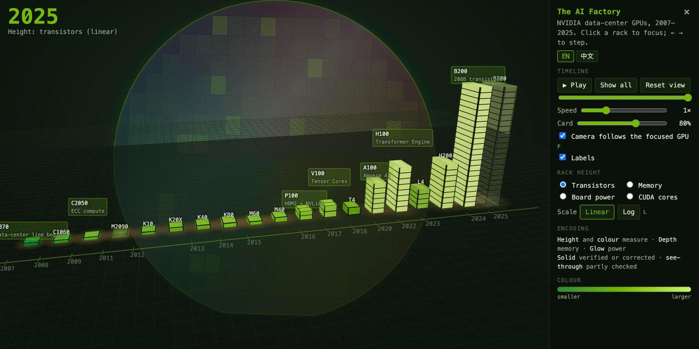

# The AI Factory

NVIDIA's data-center GPUs as a data hall, in Three.js. There are 19 chips, from the Tesla C870 (June 2007) to
the B300 Blackwell Ultra (March 2025). Each one is a server rack standing in release order along an aisle.
A rack's height is the measure you pick (linear by default, or log), its colour runs from deep green to pale
lime with the same measure, its depth is memory, and its glow and the heat on the floor are board power. Focus a rack and the camera glides to it while a card with its
specs zooms out of it. The page reads in English or Chinese (简体中文); the Chinese title is AI 工厂.

It is the data-center lane of [Tapeout](../nvidia-gpu-skyline/) given a scene of its own, with every row
checked again. Read [The data](#the-data) before quoting from it.



_The preview is a screenshot of the home view in Chrome: linear heights, the green ramp and the wafer backdrop._

## Run it

Needs a static server (ES modules and the import map won't load over `file://`). From the repository root:

```bash
python3 -m http.server 8777
# then open http://localhost:8777/nvidia-datacenter-skyline/
# or      http://localhost:8777/nvidia-datacenter-skyline/?lang=zh   for Chinese
```

Three.js r185 is pulled from unpkg via an import map. There is no build step and no `node_modules`. The page
opens with every rack standing. **Play** builds the hall from 2007, giving every GPU the same 2.5 s slot at
1×, so a full run takes about 48 s.

## Controls

| Key / input           | Action                                                                  |
| --------------------- | ----------------------------------------------------------------------- |
| drag                  | Orbit; right-drag pans, scroll or pinch zooms                           |
| hover a rack          | A short tooltip with its main figures                                   |
| click or tap a rack   | Focus it: the camera glides over and the detail card zooms out of it    |
| click empty floor     | Clear the focus                                                         |
| `←` / `→`             | Step to the previous or next GPU (also ◀ ▶ on the card)                 |
| `space`               | Play / pause the build                                                  |
| `+` / `-`             | Play speed, 0.25× to 3×                                                 |
| `F`                   | Camera follows the focused GPU: on / off                                |
| `L`                   | Height scale: linear / log                                              |
| `R`                   | Reset the view                                                          |
| `Esc`                 | Close the card                                                          |
| `H`                   | Hide the side panel; the stage widens to fill the space                 |

The side panel also holds the language switch (`EN` / `中文`, kept in `localStorage` as `ai-factory-lang` and
written to the URL as `?lang=`), the year slider, the speed slider, a card-opacity slider (40–100%, default
80%, kept in `localStorage` as `ai-factory-card-opacity`), the rack-height switch (transistors,
memory, board power or CUDA cores), the **Linear / Log** scale switch, labels on or off, the encoding key and
the colour ramp. The `×` in its corner does the same as `H`; with the panel hidden a
`Controls` button on the stage brings it back.

### The detail card

- **What it shows:** name, architecture, chip and announcement date; check status and memory type; the
  milestone, if the GPU has one; process, transistors, die size, CUDA cores, memory, board power, launch
  price and transistors per watt; the change in transistors, memory and power against the GPU before it and
  against the C870; the note; and what its check status means.
- **The zoom:** the card starts as a 3% copy on top of the focused rack and grows into place over about
  0.8 s, with a small overshoot. A frame in the rack's colour runs just ahead of it. The rack's top is
  re-projected every frame, so the card still starts from the rack while the camera is moving. Once it has
  landed, a dashed leader line joins the rack to the card when the rack's top is outside it. During playback
  the zoom runs for every release, faster at higher speeds (down to about 0.3 s at 3×).
- **Even pacing:** playback gives every GPU the same slot (2.5 s at 1×, divided by the speed), so every card
  zooms and holds for the same time. The year counter moves between release dates inside each slot, so
  quiet years such as 2019 and 2021 pass quickly. Dragging the year slider still moves through real time,
  and **Play** resumes from wherever the slider is.
- **It never scrolls.** If the stage is too short for it, the card is scaled down to fit. This is so a
  screen recording of the scene never needs a scroll.
- **It sits in the middle of the stage, over the scene,** on a desktop and a phone alike. It is see-through
  with a light blur, so the focused rack and its neighbours show behind it; the card-opacity slider sets how
  much. The rack labels stay beneath the card.

### Phones and narrow screens

"Narrow" means a stage under 760 px wide or with an aspect below 0.9; it is re-checked on resize.

- The stage sits on top and the panel below it as a sheet. The panel never covers the scene.
- The detail card is 80% of the stage's width, still centred. On stages under 560 px its specs stack in one
  pair of columns; wider narrow stages use two pairs.
- With nothing focused, the camera starts on the 2020–2025 racks. With a rack focused, it shows about three
  racks on each side of it, fitted to the tallest of them so none is cut off.
- Only the racks near the focus are labelled, so the labels don't pile up. **Show all** steps back out to
  the whole hall.

## The data

`src/data.js` holds the 19 GPUs and the 11 architectures (with the colours Tapeout uses; this scene shows the
architecture as text only). It starts from the 20
data-center rows of `../nvidia-gpu-skyline/src/data.js`. The DGX Spark is left out: it is a desktop machine
built on GB10, not a data-center part. Every row was then checked again in November 2026.

| Check status | Rows | Drawn as                                  |
| ------------ | ---: | ----------------------------------------- |
| Verified     |   10 | Solid                                     |
| Corrected    |    7 | Solid (a value changed in a check)        |
| Partial      |    2 | See-through (Tesla M2090, B300)           |

Values changed against the Tapeout dataset:

| GPU         | Change                                                                        |
| ----------- | ----------------------------------------------------------------------------- |
| Tesla C870  | Launch price $1,299 → $1,499                                                   |
| Tesla C1060 | Date 2008-12 → 2008-06-16 (announcement); launch price $1,699 added            |
| B200        | 33,792 CUDA cores added (2 × 16,896, TechPowerUp)                              |
| B300        | 20,480 CUDA cores added, worked out from NVIDIA's 160 SMs × 128 cores per SM   |

The statuses of K10, K20X, K40, A100, H100, L4 and H200 changed with no value changing: their figures were
confirmed. Each row carries the pages used in its check in a `sources` field.

What to know before relying on it:

- **TechPowerUp refused direct page reads during the check**, so its figures came from search-result
  excerpts. NVIDIA's pages, press releases and blogs, and Wikipedia, were read directly.
- **Dates are announcement dates**, not shipping dates.
- **Process node:** Hopper and Blackwell stay at 4 nm, after NVIDIA's "TSMC 4N" / "4NP". TechPowerUp lists
  H100 and B200 at 5 nm.
- **Memory is the announced per-GPU capacity.** NVIDIA's HGX B200 sheet lists 180 GB usable against the
  announced 192 GB, and HGX B300 works out to about 262 GB against 288 GB.
- **B300 is partial.** Its 1,400 W is NVIDIA's chip-level figure; no NVIDIA number for the HGX B300 board was
  found. NVIDIA gives no die codename, so "GB110" rests on third-party databases.
- **H200's core count** (16,896, the same as H100 SXM) comes from secondary spec sites; NVIDIA doesn't state it.
- **Dual-GPU and dual-die boards:** K10, K80 and M60 give transistors and die size per GPU, but cores and
  memory for the whole board. B200 and B300 give transistors and cores for the whole package; their die size
  is not published.
- **Launch prices** exist only for the early Tesla boards. NVIDIA published none for the later parts, which
  sell mostly inside DGX and HGX systems.
- **The Chinese notes and milestones were machine-written** and no native reader has reviewed them.

To change the dataset, edit `src/data.js`. A GPU needs `name`, `date` (`YYYY-MM-DD` or `YYYY-MM`), `chip`,
`arch` (one of `ARCHITECTURES`), `memory` and `status`. Other figures may be `null`; a rack with no figure for
the chosen measure stands as a grey stub, so a gap never reads as a small number.

## What's in the scene

| File          | Contents                                                                                    |
| ------------- | ------------------------------------------------------------------------------------------- |
| `index.html`  | Layout and styles, the panel and the detail card's markup; loads `main.js` with a dynamic import |
| `src/main.js` | Scene, racks, camera rig, detail card and its zoom, panel, input and the frame loop          |
| `src/data.js` | The 19 GPUs and the 11 architectures                                                         |
| `src/i18n.js` | Every string in English and Chinese, and the number and date formats                         |

### Design notes

- **One rack per GPU, in release order.** The racks stand at even spacing rather than on a true date axis.
  On a date axis 2012–2015 and 2023–2025 crowd together while 2019 and 2021 stand empty. The year marks on
  the floor sit at each year's first rack. Playback likewise gives each GPU an equal slot.
- **Several measures at once.** Height carries the chosen measure. **Linear** (the default) runs from 0 to
  12 world units, so the AI era towers over everything before it: on transistors the C870 is 0.3% of the B300
  and every rack before the P100 is under 7%. Those racks keep a minimum height of 0.25 so they can still be
  seen and clicked; the card gives the exact figures. **Log** runs from 0.8 to 12 between the smallest and the
  largest value, for reading the early years. Depth is always memory (square-root scale), and the glow and
  floor halo are always power, so the T4 and L4 (70–72 W) stand out as cool racks among hot ones.
- **One green ramp instead of architecture colours.** Racks run from deep green (smallest) through NVIDIA
  green to pale lime (largest) for the chosen measure. The ramp follows the log of the value on either scale,
  so the early racks still differ in colour when linear heights flatten them. The architecture is named on
  the card and in the tooltip. The ramp tops out short of white so that, with the brighter lighting
  (exposure 1.15, a stronger hemisphere and key light, a lighter green background), the biggest racks don't
  blow out.
- **The camera rig moves the target and the camera together.** Following a focus slides the view sideways
  and keeps any orbit angle the viewer chose; the distance eases only for the first 1.4 s after a change, so
  a zoom made during playback is kept.
- **The framing is fitted, not guessed.** Distances come from the field of view and the stage size, so the
  same code frames a 1440 px desktop and a 360 px phone.
- **The backdrop is a silicon wafer**, not a logo: a disc of dies with faint circuit blocks, a green rim and
  the rainbow sheen real wafers have (a conic gradient blended with `screen`, plus a soft diagonal highlight),
  drawn once to a canvas by `main.js` from a small hash (so it looks the same every load). It sits behind the
  transparent WebGL canvas rather than in the scene, so the whole disc stays in view at any camera angle and
  stage size. It is sized to the stage's height, shown at 60% opacity, and turns once every ten minutes; the floor is
  slightly see-through so the wafer shows faintly across it. The NVIDIA logo was left out on purpose: it is a
  trademark NVIDIA restricts.
- **The panel never covers the stage**, on a desktop or a phone. The HUD, the labels, the tooltip and the
  detail card are drawn over the scene on purpose: they are the visualization, not its controls.
- **The page works without the 3D scene.** If `main.js` fails to load (no WebGL, or the CDN is unreachable)
  the page shows a notice in both languages.
- **Chinese numbers use 万 and 亿**: 681 M is 6.81 亿 and 208 B is 2080 亿. Dates read 2022年3月22日.
  GPU, chip and architecture names stay in English.
- `prefers-reduced-motion` makes heights jump instead of easing, drops the card's zoom and its frame, the
  heat pulse, the wafer's turning and the camera damping, and moves the camera straight to its mark.

### Verified

- **Data:** the 19 rows in `src/data.js` match, field for field, the dataset approved before the build
  (`dc_verified_final.csv`, with B200 memory at 192 GB).
- **Static checks:** all three modules pass `node --check`; the English and Chinese string tables have the
  same keys; every `data-i18n` attribute names a string.
- **In Chrome**, against the real Three.js r185 from unpkg, with no console errors or warnings:
  - Desktop at 1440×683: the whole hall fits the home view, and neither the panel nor the card scrolls.
  - The zoom was sampled frame by frame. The card starts at the rack's top at 3–5% scale, lands at about
    0.33 s and settles at 0.8 s.
  - Switching language with a card open re-renders the card, panel and labels, and updates the URL and
    `localStorage`.
  - Phone-sized frames at 390×640 and 360×600, in both languages: the card fits without scrolling and
    playback follows the newest GPU.
  - The card is centred on the stage to the pixel, and the rack labels draw beneath it.
  - Playback at 3×: all 19 GPUs held for 833 ± 9 ms each (2.5 s ÷ 3).
  - The card measures 80% of the stage width on 390 px and 360 px phone frames, linear and log, in both
    languages, without scrolling or clipping.
- **Not yet checked:** a real phone (touch, pinch and the mobile browser's address bar), other browsers, and
  frame rate on slower GPUs.
