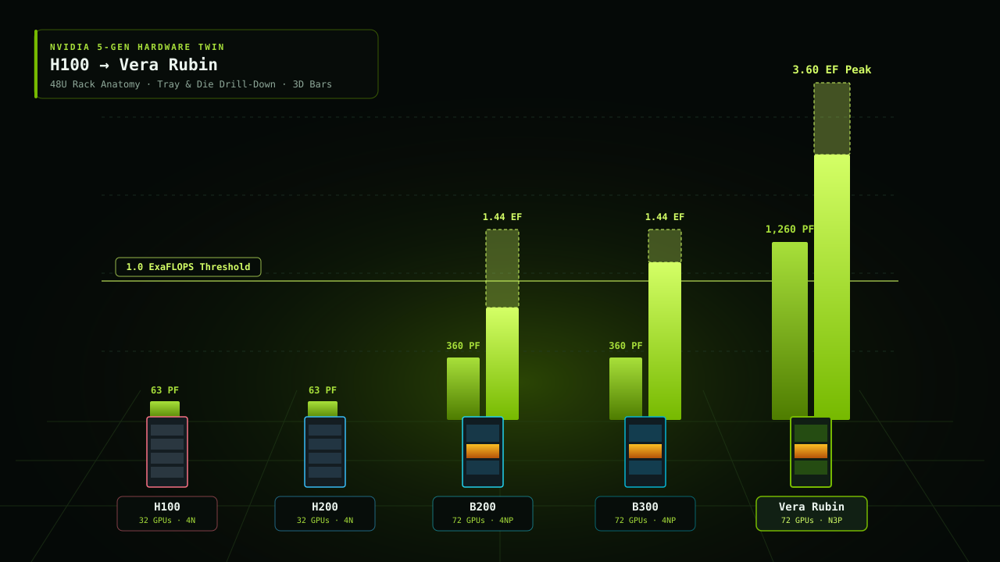

# Five Generations (五代机柜演进)

An interactive Three.js 3D hardware twin and 12-chapter guided tour comparing five consecutive generations of NVIDIA data-center architectures — **H100, H200, B200 (GB200 NVL72), B300 (GB300 NVL72), and Vera Rubin NVL72** — across 48U rack anatomy, compute tray & silicon die drill-downs, and embedded 3D comparative bar charts.

The experience runs in **English** or **Chinese (简体中文)** (`?lang=zh`), is responsive across desktop and portrait mobile recording, and requires no build step.



## Run it

Needs a static HTTP server (ES modules + import map won't load over `file://`). From the repository root:

```bash
python3 -m http.server 8777
# open http://localhost:8777/nvidia-five-gen-racks/
# or   http://localhost:8777/nvidia-five-gen-racks/?lang=zh
# or   http://localhost:8777/nvidia-five-gen-racks/?ch=9   (jump directly to chapter 9)
```

Three.js r185 is loaded from unpkg via an import map. No `node_modules`, no bundler.

## Controls & Shortcuts

| Key / Input | Action |
| :--- | :--- |
| Drag / Scroll / Pinch | Orbit, zoom, and pan the 3D scene |
| Click any rack | Focus that generation for rack anatomy inspection |
| `Space` | Play / pause the 12-chapter guided tour |
| `←` / `→` | Previous / next tour chapter |
| `R` | Restart the guided tour from Chapter 1 |
| `F` | Flip rack **180°** between Front (`0°`) and Rear (`180°`) |
| `H` | Collapse or expand the non-overlapping Control Panel |

All controls live inside the collapsible side/bottom panel:
- **Language / 语言**: `English` / `中文 (简体)` (saved to `localStorage` as `five-gen-racks-lang` and synced to `?lang=`).
- **Guided Play Script**: Transport (`⏮`, `▶ Play Tour`, `⏭`, `↺`), speed (`0.75×`, `1.0×`, `1.4×`), auto-hide panel while playing, and clickable 12-chapter list.
- **Embedded 3D Bar Comparison**: Compute (FP8 & FP4 with `1.0 ExaFLOPS` plane), HBM Capacity & Bandwidth, NVLink Domain & SuperNIC, Power (kW) & Perf/kW (with `50 kW Air-Cooling Ceiling` plane), Fast Memory Pool (HBM + CPU RAM), or Hardware Only.
  - Whenever a 3D bar comparison is active, the 5 racks smoothly shrink into miniature 3D hardware icons along the front axis so the 3D bars rise completely unobstructed center-stage.
- **Anatomy Drill-Down Flow**: `1. Rack → 2. Tray/Node → 3. Silicon Die`, **180° Rack Orientation (`Front 0° / Rear 180°`)**, **Explode Separation** slider, **X-Ray Schematic**, **View-Aware 3D Callout Pins** (front labels appear only when viewing the front; rear backplane/manifold labels appear only when rotated 180° into view), **Cinema Bloom**, and **Mobile Status Bar Safe-Area (52px)** + **Clean View** for screen recording.

## 12-Chapter Guided Tour (Interleaved by Architecture)

1. **Act I · Lineup (Ch. 1)**: All five 48U racks side-by-side (`H100 → Vera Rubin`, L→R close-up pass → holistic overview).
2. **Act II · Hopper (`H100 → H200`, Ch. 2–3)**: 48U air-cooled rack anatomy (`4× 8U` servers, 32 glowing green GPUs, blanking panels) followed by a **seamless zoom-in directly from the rack's GPUs** into the exploded Hopper monolithic `4N` silicon package (5→6 HBM3/HBM3e stacks + Xeon CPU).
3. **Act III · Blackwell (`GB200 → GB300 NVL72`, Ch. 4–5)**: `10 upper + 9 central NVLink 5 switch + 8 lower` 1U trays with automatic **180° Front → Rear → Front spin**, followed by a **seamless zoom-in from a 1U tray GPU** into the exploded Blackwell Ultra dual-die + 10 TB/s NV-HBI bridge + 12-Hi HBM3e + Grace CPU.
4. **Act IV · Vera Rubin (`NVL72`, Ch. 6–8)**: `MGX v3` cable-free rack with **180° spin** to the 260 TB/s emerald cartridge spine → **1U liquid-cooled blade pull-out** (`4 Rubin GPUs + 2 Vera CPUs`) → **seamless zoom-in straight from a GPU on the pulled-out blade** into the exploded `3nm N3P` dual-die + I/O chiplets + 22 TB/s HBM4 + Vera CPU.
5. **Act V · Embedded 3D Bar Comparisons (Ch. 9–12)**: Compute (`19.9×` FP8, `2.52 EF` dense / `3.60 EF` peak NVFP4), HBM (`14.8×` rack BW to `1,584 TB/s`), NVLink (`36.1×` unified domain to `260 TB/s`), and Power vs. Efficiency (`3.9×` more FP8 PFLOPS/kW).

## Mobile & Portrait Screen Recording

- Chapter narration, metric legends, and the slim progress bar live inside the **top header card** (subtitle) so the entire lower stage, rack bases, and floor tags remain 100% unobstructed.
- On narrow/portrait viewports (`aspect < 0.88` or width `≤ 860 px`), the control panel starts collapsed to maximize 3D space and reserves top clearance when **Mobile Status Bar Safe-Area** is enabled.
- During the guided tour, wide 5-generation chapters (Ch. 1 and Ch. 9–12) and Silicon Die + CPU chapters (Ch. 6–8) perform a **2-phase camera choreography**:
  1. **Phase A (Left → Right close-up pass)**: Tracks one by one (`H100 → H200 → B200 → B300 → Vera Rubin`, or HBM → Dual-Die → CPU) at readable scale with full callout & dual-bar labels.
  2. **Phase B (Holistic Zoom-Out)**: Pulls back smoothly to a centered full-scene overview; on narrow/squeezy screens, compact label mode automatically omits secondary subtitles/secondary bar pills and shortens long callout text so nothing collides.
- In manual explore mode, static wide views compute exact horizontal frustum distance and compact rack spacing so all 5 racks fit cleanly inside narrow screens.

## The Data

All specifications live in `src/data.js`, compiled from official NVIDIA datasheets and DGX SuperPOD / NVL72 reference architectures:
- **Dense baseline** is default for compute (`BF16`, `FP8`, `FP4`), with peak/sparse FP4 toggleable (`1.33×` on B300 `15→20 PF`, `1.43×` on Rubin `35→50 PF` NVFP4 training vs. inference).
- Estimated/deployment-dependent values (`~45 kW` 4-node Hopper SuperPOD rack assumption; `~230 kW` Vera Rubin Max-P operational power estimate) are explicitly flagged with `*`.
