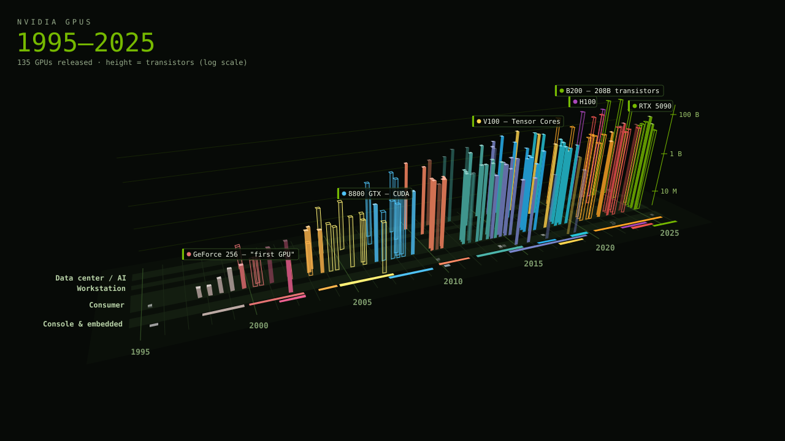

# Tapeout

Thirty years of NVIDIA GPUs as a city skyline, in Three.js. There are 135 chips, from the NV1 in May 1995 to
the DGX Spark in October 2025. Each one is a tower, placed by release date along the street in one of four
market lanes and coloured by its architecture. By default a tower's height is its transistor count, on a log
or a linear scale; it can also show process node or power draw. The page reads in English or Chinese
(简体中文).

A tapeout is the moment a finished chip design is sent to the fab. In Chinese it is 流片, which is the page's
Chinese title.

Like Cohort and Groundswell, this is a scene whose content is data rather than procedure. The dataset was put
together for this scene and has been only partly checked against sources. Read [The data](#the-data) before
quoting from it.



_The preview is an SVG drawing of the home view, generated from `src/data.js` with the scene's own camera. It is
not a screenshot._

## Run it

Needs a static server (ES modules and the import map won't load over `file://`). From the repository root:

```bash
python3 -m http.server 8777
# then open http://localhost:8777/nvidia-gpu-skyline/
# or      http://localhost:8777/nvidia-gpu-skyline/?lang=zh   for Chinese
```

Three.js r185 is pulled from unpkg via an import map. There is no build step and no `node_modules`. The page
opens with every release standing. **Play** builds the skyline from 1995, which takes about 24 s at 1x.

## Controls

| Key / input           | Action                                                              |
| --------------------- | ------------------------------------------------------------------- |
| drag                  | Orbit; right-drag pans, scroll zooms                                |
| hover a tower         | Its specs: date, architecture, chip, process, transistors, die, cores, memory, power, price, a note and its check status |
| click a tower or bar  | Spotlight its architecture and dim the rest; click again to clear   |
| click empty ground    | Clear the spotlight                                                 |
| `space`               | Play / pause the build                                              |
| `L`                   | Transistor scale: log / linear                                      |
| `R`                   | Reset the view                                                      |
| `F`                   | Camera follows the year: on / off                                   |
| `Esc`                 | Clear the spotlight                                                 |
| `H`                   | Hide the side panel; the stage widens to fill the space             |

The side panel also holds:

- **Language:** `EN` / `中文`. The choice is kept in `localStorage` (`tapeout-lang`) and written to the URL as
  `?lang=`. Switching keeps the camera and every setting where they are.
- **Timeline:** play / pause, show all, reset view, a year slider, a speed slider (0.5x to 3x) and
  **Camera follows the year**. That is on by default when the stage is under 760 px wide or taller than
  wide (a phone, or a small window with the panel open); see [Phones and narrow screens](#phones-and-narrow-screens).
- **Tower height:** transistors, process node (smaller is taller) or power draw, and the **Log / Linear**
  switch for transistors. The switch also puts the height back on transistors, the only measure it applies to.
- **Markets:** a checkbox per lane, with its count.
- **Architecture:** the 18 families with their counts. Clicking one spotlights it.
- **Display:** milestone labels on or off, and the key to how solid a tower is.

The `×` in the panel's corner does the same as `H`. With the panel hidden, a `Controls` button in the corner of
the stage brings it back.

### Phones and narrow screens

The skyline is 31 years wide. On a phone the home view either can't fit it (portrait, with the panel hidden)
or fits it at about 12 px a year, too small to read. So on a narrow stage the camera **follows the year**:

- **Play** eases the camera in to a window of 7 to 14 years (about 42 stage pixels a year) and slides it along
  as the skyline builds. The year being built sits a little right of centre, so the years just built stay in
  view beside it.
- **Dragging the year slider** does the same, so scrubbing moves through time instead of growing towers
  off-screen.
- Only the sideways position is tracked once the camera is in, so an orbit, pinch-zoom or tilt made during
  playback is kept. A drag during the ease-in stops the ease-in but not the following.
- When the build ends the camera stays on 2025. **Show all** and **Reset view** step back out to the whole
  skyline.
- The view never runs past the lane names at the left or the scale at the right.

"Narrow" means a stage under 760 px wide or with an aspect below 0.9. It is re-checked on resize, so turning a
phone or closing the panel can switch it. The checkbox or `F` overrides the default for the visit, and also
works on a wide screen.

## The data

`src/data.js` holds 135 GPUs, the four markets and the 18 architectures with their colours.

| Market (lane, front to back) | GPUs | Includes                                                     |
| ---------------------------- | ---: | ------------------------------------------------------------ |
| Console & embedded           |   13 | Xbox NV2A, PS3 RSX, Tegra, Jetson, Nintendo Switch and Switch 2 |
| Consumer                     |   88 | NV1 and RIVA, GeForce, Titan                                 |
| Workstation                  |   14 | Quadro, RTX A / Ada / PRO                                    |
| Data center / AI             |   20 | Tesla, A100, H100, H200, B200, B300, L4, DGX Spark           |

| Check status | Rows | Drawn as                     |
| ------------ | ---: | ---------------------------- |
| Verified     |   52 | Solid                        |
| Corrected    |   24 | Solid (a value changed in the check) |
| Partial      |   17 | See-through                  |
| Unverified   |   42 | Hollow: a bright outline     |

Fields: name, date, chip, architecture, market, process (nm), transistors (millions), die (mm²), cores,
memory (GB) and type, board power (W), launch price (US$), a note, and for 19 rows a milestone label. Every
note and milestone also has a Chinese version.

What to know before relying on it:

- **The rows were first written from memory** of public spec sheets. 93 have since been checked against
  TechPowerUp, Wikipedia or NVIDIA's pages; 24 of those had a value corrected. **The other 42 are unchecked.**
  They are mostly the GeForce 6 to 9 series and the RTX 30 and 40 series. The first check stopped when the
  search service hit its usage limit.
- **The data-center rows were checked again in November 2026** for [The AI Factory](../nvidia-datacenter-skyline/),
  which carries the sources for each. That check corrected the Tesla C870's launch price ($1,299 → $1,499) and
  the Tesla C1060's date (2008-12 → 2008-06-16) and added its price ($1,699); it added CUDA core counts for the
  B200 (33,792) and B300 (20,480, worked out from NVIDIA's 160 SMs × 128); and it confirmed the K10, K20X, K40,
  A100, H100, L4 and H200 unchanged. The B300 stays partial and the DGX Spark unverified.
- **The "partial" rows rest in part on spec-aggregator sites**, not on NVIDIA or TechPowerUp.
- **Data-center and workstation products are dated by announcement**, not by shipping (H100, H200, B200,
  B300, RTX PRO 6000, Quadro RTX 8000 and others). Ten rows are known to the month only and sit mid-month.
- **Process node is as TechPowerUp lists it,** except that Hopper and data-center Blackwell stay at 4 nm,
  after NVIDIA's "TSMC 4N" / "4NP" (TechPowerUp lists H100 and B200 at 5 nm). Ada and consumer Blackwell are
  at 5 nm, though all are TSMC "4N". The Switch 2's T239 is listed at 8 nm; a shrink to 5 nm is disputed.
- **Dual-GPU boards** (9800 GX2, GTX 295, GTX 690, Titan Z, K10, K80, M60) give transistors and die size per
  GPU, but cores and memory for the whole board. The dual-die B200 and B300 give transistors and cores for the package.
- **Eight GPUs have no transistor count**, among them the NV1, Tegra 2, Tegra K1 and DGX Spark. They stand as
  grey stubs while height is on transistors.
- **The Chinese translations were machine-written** and no native reader has reviewed them.

To change the dataset, edit `src/data.js`. A GPU needs `name`, `date` (`YYYY-MM-DD` or `YYYY-MM`), `chip`,
`arch` (one of `ARCHITECTURES`), `market` (one of `MARKETS`) and `status`. Every figure may be `null`. Sub-rows,
lanes and the architecture bars are worked out from the data on load.

## What's in the scene

| File             | Contents                                                                                |
| ---------------- | --------------------------------------------------------------------------------------- |
| `src/main.js`    | State, playback clock, tooltip, input, boot splash, frame loop, cleanup                 |
| `src/data.js`    | The 135 GPUs, the four markets and the 18 architectures                                 |
| `src/scales.js`  | Time axis, lanes, sub-rows, architecture bars and the three height measures; no DOM and no Three.js |
| `src/i18n.js`    | Every string in English and Chinese, and the date, number and unit formats               |
| `src/panel.js`   | The side panel: builds its lists, writes its text, mirrors the state                     |
| `src/world.js`   | Renderer, label layer, camera and orbit controls, the fitted home view, the follow view, picking, disposal |
| `src/towers.js`  | The towers: shared box geometry, per-tower materials, height easing, milestone labels    |
| `src/ground.js`  | Floor, lane strips and names, year grid, architecture bars, the playback "now" gate      |
| `src/gauge.js`   | The scale beside the towers and the guide lines along the back                           |
| `src/marks.js`   | Shared builders: HTML labels, line segments, releasing an object tree                    |

### Design notes

- **The tallest lane is at the back.** Lanes run front to back as console & embedded, consumer,
  workstation, data center. The data-center towers, which hold every record since the A100, stand behind
  everything else instead of hiding it.
- **Close releases share a lane without touching.** Two GPUs less than three months apart in one lane go to
  different sub-rows, first fit. The consumer lane needs five sub-rows, console and data center two,
  workstation one.
- **The heights are honest.** Transistors run from 2 M to 208 B on a log scale, or 0 to 208 B on a linear one.
  Process is a log scale from 600 nm down to 3 nm, with smaller standing taller. Power is a log scale from 8 W
  to 1.4 kW. On the linear scale 61 of the 127 towers with a count are under 2% of the B200's height; the
  hint under the switch says so.
- **How solid a tower looks is how well its row was checked.** Verified and corrected rows are solid,
  partial rows see-through, and unverified rows are a bright outline round an almost empty box. A tower with
  no figure for the chosen measure is a grey stub, so a gap in the data never looks like a small number.
- **The scale stands in the scene.** It sits at the end of the consumer lane and is rebuilt only when the
  measure, the transistor scale or the language changes. Faint lines at the same heights run along the back
  of the scene, so a tower anywhere can be read against them.
- **The home view is fitted, not guessed.** The camera looks across from 22° left and 26° up. Its distance
  is 106 ÷ the stage's aspect ratio, clamped to 42–150, a fit worked out offline so that the lane names, all
  31 years and the scale stay in frame on stages from 1:1 to 2.2:1. Resizing does not move the camera.
  **Reset view** re-fits it to the current stage.
- **Labels are HTML, drawn by `CSS2DRenderer`.** They stay sharp at any zoom, use the browser's Chinese
  fonts, and change language in place without rebuilding the scene. The lane names in the scene are short,
  one-line versions, because the back lanes are only about 20 px apart at the left end. The full names are
  in the panel.
- **One state, several mirrors.** `main.js` owns the state. The panel, the HUD and the world each draw from
  it every frame or on change, so a key press, a click on a tower and a panel control can never disagree.
- **The panel never covers the stage.** It is a 320 px column beside the canvas, or below it on narrow
  screens. The tooltip is kept inside the stage. The HUD, the labels and the tooltip are drawn over the
  scene on purpose: they are the visualization, not its controls.
- **The page works without the 3D scene.** `main.js` imports no Three.js. It loads `world.js` with a dynamic
  import, and if that fails (no WebGL, or the CDN is unreachable) the panel still comes up under a short
  notice.
- **Chinese numbers use 万 and 亿**, as Chinese tech media writes them: 57 M is 5700 万, 3.1 B is 31 亿, and
  208 B is 2080 亿. Dates read 1995年5月22日. GPU, chip and architecture names stay in English.
- **Nothing is random**, so there is no `rng.js` and no `?seed=`.
- `prefers-reduced-motion` makes heights jump instead of easing, drops the glow on new towers and the
  camera damping, and removes the CSS transitions. A following camera jumps to its mark instead of
  gliding.

### Skills referenced

- `threejs-fundamentals`: renderer, camera, `ResizeObserver` resize, `Object3D` hierarchy, disposal.
- `threejs-geometry`: one shared `BoxGeometry` and `EdgesGeometry` for every tower, scaled in y; line segments.
- `threejs-materials`: `MeshStandardMaterial` with emissive glow and per-tower transparency, `LineBasicMaterial` edges.
- `threejs-lighting`: hemisphere fill plus a directional key light.
- `threejs-interaction`: `OrbitControls`, `Raycaster` picking of towers and bars, click-versus-drag, keyboard.

### Verified

- **Data:** the 135 rows in `src/data.js` match, field for field, the dataset approved before the build, with
  the November 2026 data-center corrections applied on top (11 rows; see [The data](#the-data)).
- **Static checks**, run in Python because no browser was available:
  - Brackets, strings and template literals balance in all ten modules.
  - Every import matches an export.
  - Every element ID the scripts ask for exists in `index.html`.
  - The English and Chinese string tables have the same keys at every level.
  - Every `data-i18n` attribute names a string.
- **Layout:** `prepare()` was reproduced in Python. It places every tower where the approved prototype did,
  except the Jetson TK1, which moves one sub-row because month-only dates now sit mid-month. The architecture
  bars stack into the same rows.
- **Home view:** the framing was checked by projecting the scene's corners, the tallest towers, the scale
  and the lane names through the home camera at aspect ratios from 0.6 to 2.2.
- **Follow view:** projected through the follow camera on stages from 360×640 to 760×900, for years from
  1995 to the end of 2025. The front and back lanes and the tallest towers with their labels stay within 90%
  of the frame. The year being built is always in view with 6 to 7 years of history to its left, and at the
  end the 2025 towers and the scale are both in frame.
- **Not yet checked:** the page has not been opened in a browser. It has not run against the real Three.js
  r185, been drawn by a GPU, or had its frame rate measured, so how it looks and feels is unverified. The
  prototype it was built from used Three.js r160.
