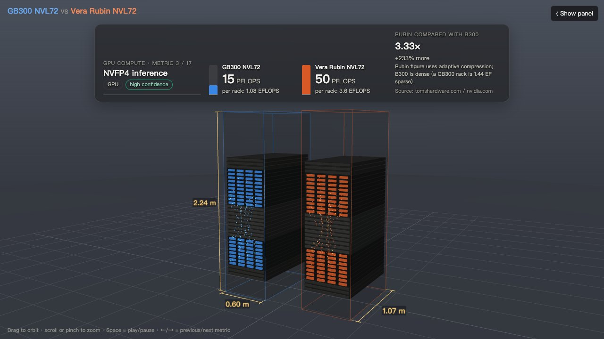

# Twin Racks

NVIDIA's GB300 NVL72 and Vera Rubin NVL72 side by side, in Three.js, at true physical size. Both systems use
the same NVL72 rack (about 0.60 × 1.07 × 2.24 m), so the racks themselves carry no data. The difference is on a
spec card under the title, one metric at a time: 16 specs across the GPU, the CPU and the whole rack, each with
two bars whose height is proportional to the value. The part of the rack a metric describes (GPUs, CPUs, NVLink
switch trays, network cards or power shelves) lights up, and the camera glides to it. The page reads in English
or Chinese (简体中文); the Chinese title is 双机柜对比.

Rubin's figures are NVIDIA's launch specs, not measurements. Read [The data](#the-data) before quoting from it.



_The preview is a screenshot in Chrome at 1280×720 with the panel hidden, on the NVFP4 inference metric._

## Run it

Needs a static server (ES modules and the import map won't load over `file://`). From the repository root:

```bash
python3 -m http.server 8777
# then open http://localhost:8777/nvidia-rack-comparison/
# or      http://localhost:8777/nvidia-rack-comparison/?lang=zh   for Chinese
```

Three.js r185 is pulled from unpkg via an import map. There is no build step and no `node_modules`. The page
opens on a title frame with the tour paused. **Play tour** steps through two text frames and then all 16 metrics, 5 s
each by default. `?m=N` opens metric N (0-based) directly.

## Controls

| Key / input         | Action                                                                   |
| ------------------- | ------------------------------------------------------------------------ |
| drag                | Orbit; right-drag pans, scroll or pinch zooms                            |
| hover a part        | A tooltip naming the part (GPU, CPU, switch tray, NIC, power shelf) and its main figures |
| tap a part (touch)  | The same tooltip, for about 3 s                                          |
| swipe the card      | Previous or next metric                                                  |
| `←` / `→`           | Previous or next metric                                                  |
| `space`             | Play / pause the tour                                                    |
| `F`                 | Camera follows the highlighted part: on / off                            |
| `H`                 | Hide or show the side panel                                              |

Every control is in the side panel; the card carries none. The panel holds the language switch (`English` /
`中文`, kept in `localStorage` as `twin-racks-lang` and written to the URL as `?lang=`), **Prev / Play tour /
Next**, seconds per metric (2–12, default 5), camera follow, loop, whether the card floats over the scene or
docks as a strip below it, whether the card shows the note and source (on by default on a desktop, off on a
phone), the card opacity (0–100%, default 55%, kept in `localStorage` as `twin-racks-card-opacity`), the
NVLink-traffic and rack-dimension layers, and the list: the two frames, then all 16 metrics with Rubin's ratio to B300.

### The opening frames

Before the spec cards, the same card shows two text frames, which slide like the rest and are in the tour and
the panel's list (under "Intro"):

1. **Title slide:** "Nvidia Vera Rubin vs B300 comparison", subtitled "Nvidia's new generation of data center
   chips — Vera Rubin against B300", with a two-colour rule and how to begin. Like a deck's opening slide, the
   card grows to fill the stage under the header and covers the racks (at least 90% opaque whatever the
   opacity setting); the dimension labels and the hint are hidden behind it, and the camera frames the racks as
   if it weren't there, so they are ready when it shrinks back. Nothing on the racks is lit.
2. **Overview, "Same rack, different chips":** the rack size (0.60 × 1.07 × 2.24 m, the same for both and drawn
   to true size), and each system's contents, one line per part: 72 GPUs (B300 / Rubin), 36 CPUs (Grace / Vera),
   18 compute trays and 9 NVLink switch trays. The frame walks through the four lines in turn: the line is
   emphasised in both columns, tinted in the system's colour, while the same part lights up on both racks (the
   GPUs; the CPUs, with the tray covers made see-through; the compute-tray bodies; the switch trays). One full
   walk takes one tour step (1.25 s per part at the default 5 s, never under 0.9 s) and repeats while the frame
   is shown.

This replaces the subtitle and the per-card "72 × B300 · 36 × Grace" lines of earlier versions, so the counts
are said once instead of on every card. Going back from the title wraps to the last metric.

### The spec card

- **What it shows:** the metric and its group, chips for its scope (GPU, CPU or rack), its confidence and, for
  power and price, "cost (lower is better)"; the GB300 NVL72 and Vera Rubin NVL72 values; on six cards, the rack total under each value; Rubin's
  ratio to B300 and the change in per cent; and the note and source.
- **Rack totals:** where a rack figure is only the GPU figure × 72 (FP4 inference and training, HBM capacity and
  bandwidth, NVLink), it is a "per rack" line on the GPU card, e.g. "per rack: 1.08 EFLOPS" under 15 PFLOPS,
  rather than a card of its own; the rack's fast memory (72 GPUs' HBM plus 36 CPUs' LPDDR5X) sits on the CPU
  memory card as "per rack (HBM + CPU)". The line shows the published rack figure, which is sometimes rounded (Rubin's 2.5 EFLOPS
  training against 35 × 72 = 2.52). Only rack power, price and availability, which are not a multiple of a
  chip figure, keep their own cards. Phone landscape hides the line.
- **The bars:** one per system, sharing a zero baseline. The larger value fills the bar; the other is drawn to
  scale, so FP4 inference reads 15 : 50 and FP64 1.2 : 33. Text metrics (process node, availability) hide them.
- **Where it sits:** centred under the title, over the scene, see-through with a light blur. The system names
  live only here and in the title, which colours them blue and orange to match the racks.
- **On a wide screen** it is one row; on a phone two columns; in phone landscape one compact row without the
  chips and notes.
- **Changing metric:** the card's frame stays put while its contents slide out (170 ms) and the next metric's
  slide in from the other side (300 ms), the title first and the values and the comparison a beat after it.
  Forward (Next, →, the tour, a swipe left) slides left; back slides right; picking from the list slides in
  the direction of the jump. A newer change cancels a slide part-way, so quick presses never queue. The
  numbers then count up from the previous metric's.

### Phones and narrow screens

"Narrow" means a stage under 760 px wide.

- The stage sits on top and the panel below it. The panel starts closed; **☰ Controls** opens it, and while it
  is open the floating card is hidden so it doesn't cover the smaller scene.
- A preview frame can report a phone width while it loads. If the panel was closed for that reason, it opens
  again once the stage is wide.

## The data

`src/data.js` holds the 16 rows, in tour order, six of them with a rack total, with a confidence for each and the sites each figure came from.
They were gathered from public reporting in November 2026 and approved before the build.

| Confidence | Rows |
| ---------- | ---: |
| High       |    8 |
| Medium     |    7 |
| Low        |    1 |

What to know before relying on it:

- **Rubin's 50 PFLOPS NVFP4 inference uses NVIDIA's adaptive compression; B300's 15 PFLOPS is dense.** The
  3.33× on the card is the launch-spec ratio; a like-for-like inference gain is likely smaller.
- **FP8 is left out.** NVIDIA gives no per-GPU FP8 figure for Rubin; the approved dataset worked one out (rack
  ~1.8 EFLOPS ÷ 72 ≈ 25 PFLOPS, against B300's 5 dense) at low confidence, and it was dropped from the scene.
- **Rack prices are analyst estimates** (Morgan Stanley: ~$4.0M GB300, ~$7.8M Vera Rubin). NVIDIA publishes no
  prices; other estimates range from $5M to $9M for Vera Rubin. Low confidence.
- **Rubin's power has two modes.** The card uses Max-P (~2.3 kW per GPU, 227 kW per rack); Max-Q is ~1.8 kW and
  187 kW.
- **Shipping dates disagree:** reports put the first Vera Rubin racks at June 2026 (Dell to CoreWeave), while
  NVIDIA said production shipments began in August 2026.
- **Process node:** the card keeps NVIDIA's and TSMC's names (TSMC 4NP, TSMC N3P) and adds the node size most
  readers know after them: "4 nm" and "3 nm". 4NP is NVIDIA's custom version of N4P and is marketed as 4 nm,
  which is also how _The AI Factory_ and _Tapeout_ list Hopper and Blackwell. Strictly,
  [TSMC classes N4P](https://pr.tsmc.com/english/news/2874) as "the third major enhancement of TSMC's 5nm
  family"; the card's note says so. Rubin's I/O dies are reported on N5B; the card describes the compute dies.
- **Most sources are secondary** (Tom's Hardware, StorageReview, SiliconANGLE, vendor and cloud blogs). The full
  list of pages is `SOURCES` in `src/data.js`.
- **The rack geometry is schematic.** The outer size follows the Oberon-class NVL72 rack; the tray layout
  (power shelves, 18 compute trays with 4 GPUs and 2 CPUs each, 9 NVLink switch trays) is accurate in count but
  not in exact position.
- **The Chinese strings and notes were machine-written** and no native reader has reviewed them.

To change the dataset, edit `src/data.js`. A row needs `id`, `group`, `part` (which part lights up), `scope`,
`unit`, `b300`, `rubin` and `confidence`. Numeric values are numbers; text rows use `unit: "text"` and give
their Chinese forms in `textZh`. Add the Chinese metric name to `metricNames` in `src/i18n.js`.

## What's in the scene

| File          | Contents                                                                                     |
| ------------- | -------------------------------------------------------------------------------------------- |
| `index.html`  | Layout and styles, the panel and the card's markup; loads `main.js` with a dynamic import    |
| `src/main.js` | Scene, racks, dimension lines, particles, fitted camera, spec card, panel, input, frame loop  |
| `src/data.js` | The 16 specs (and 6 rack totals), the rack size, the NVLink speeds and the source list                           |
| `src/i18n.js` | Every string in English and Chinese, and the number formats                                  |

### Design notes

- **True size, not data size.** An early version drew each GPU's spec as a bar sticking out of the rack. It
  made Rubin look like a bigger machine, which it isn't, so the racks are now drawn to their real size and the
  comparison moved to the card. A person-height figure and then a ruler were tried for scale; dimension lines
  drawn on the racks themselves (2.24 m high, 0.60 m wide, 1.07 m deep) read most directly.
- **Light the part, not the rack.** Each metric names the part it describes: compute and memory light the GPUs,
  CPU metrics make the tray covers see-through and light the CPUs inside, NVLink lights the switch trays, the
  scale-out network the NICs at the back (the camera turns round to them), and rack power raises a column
  above each rack in proportion to its kilowatts.
- **The framing is fitted, not guessed.** Each view is only a direction. The distance and target are solved so
  the racks, their dimension labels and (for power) the columns fill the stage below the card, with the same
  16 px gap from the title to the card, the card to the racks and the racks to the bottom. It re-fits on every
  metric, resize, language switch and card-size change.
- **Two colours, one meaning.** Blue is GB300 NVL72 and orange is Vera Rubin NVL72 everywhere: the title, the
  card's bars, the rack frames, the GPUs and the NVLink particles. The particles' speed is the per-GPU NVLink
  bandwidth, so Rubin's run twice as fast.
- **The panel never covers the stage**, on a desktop or a phone. The card is drawn over the scene on purpose:
  it is the visualization, not a control.
- **The page works without the 3D scene.** If `main.js` fails to load (no WebGL, or the CDN is unreachable)
  the page shows a notice in both languages. `localStorage` is read and written inside `try`, so a sandboxed
  preview that blocks it still runs.
- `prefers-reduced-motion` drops the card slide, the camera glide, the count-up and the pulsing highlight.

### Verified

- **Data:** the 16 rows and the 6 rack totals in `src/data.js` hold 22 of the 23 rows of the approved dataset
  (`b300_vs_rubin_specs.csv`), value for value; the 23rd, FP8, was removed on purpose.
- **Static checks:** all three modules pass `node --check`; the English and Chinese string tables have the same
  keys; every `data-i18n` attribute names a string; every metric, group and note has a Chinese form.
- **In Chrome**, against the real Three.js r185 from unpkg, with the repository served over HTTP:
  - Desktop 1440×900 in English and Chinese, iPhone 13 portrait and landscape, and a 500 px-wide frame: no
    console errors, no horizontal overflow, no controls on the card.
  - Switching to Chinese updates the page, the URL (`?lang=zh`), the document title and `localStorage`.
  - The tour, driven with a simulated clock at 2 s per metric, moves on at 2.0 s, 4.0 s and 6.0 s.
  - With the CDN blocked, the notice appears.
  - The overview walk, stepped through with a test hook: each step emphasises the matching line in both columns
    and lights exactly 144 GPUs, 72 CPUs, 36 compute trays or 18 switch trays across the two racks (twice the
    per-rack counts); leaving the frame restores the next metric's highlight.
  - The card slide, with its animations paused at fixed times: at 85 ms into Next the old contents sit 9 px
    left at 68% opacity; at 120 ms the new ones come in from the right; Prev mirrors both. Four quick → presses
    settle on the fourth metric with no animation left running; with reduced motion the card swaps at once.
  - In the visual review, the card's bars matched the value ratios (e.g. 18.6 px against 62 px for 15 : 50 PFLOPS).
- **Not yet checked:** a real phone (touch, pinch and the address bar), browsers other than Chrome, and frame
  rate on slower GPUs.
