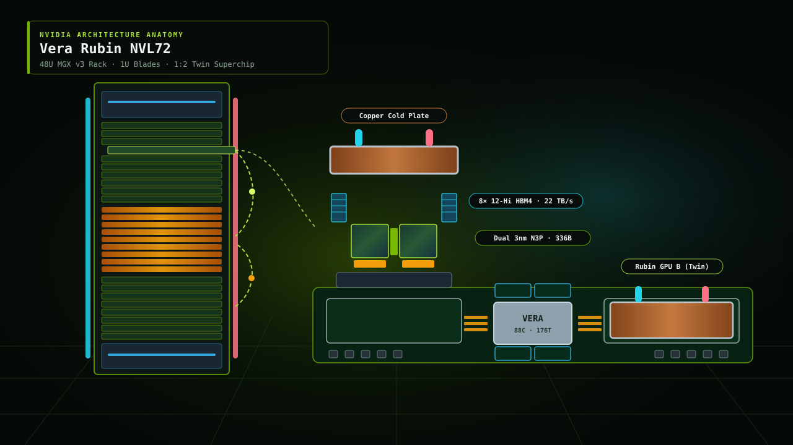

# Vera Rubin NVL72 — Rack Anatomy (Vera Rubin 机柜解剖)

An interactive Three.js 3D hardware twin and 8-chapter guided presentation exploring the **NVIDIA Vera Rubin NVL72 (MGX v3)** architecture across four anatomical tiers — from the cable-free 48U cabinet and 1U liquid-cooled compute/switch blades down to the **1:2 Vera-Rubin Superchip**, iridescent `3nm N3P` silicon dies, `12-Hi` laminated `HBM4` stacks, and modular `SOCAMM` memory cards.

The experience runs in **English** or **Chinese (简体中文)** (`?lang=zh`), renders with WebGL2 **4× MSAA** bloom + PBR studio reflections, is responsive across desktop and portrait mobile screen recording, and requires no build step.



## Run it

Needs a static HTTP server (ES modules + import map won't load over `file://`). From the repository root:

```bash
python3 -m http.server 8777
# open http://localhost:8777/nvidia-vera-rubin-anatomy/
# or   http://localhost:8777/nvidia-vera-rubin-anatomy/?lang=zh
# or   http://localhost:8777/nvidia-vera-rubin-anatomy/?ch=7   (jump directly to chapter 7)
```

Three.js r185 is loaded from unpkg via an import map. No `node_modules`, no bundler.

## Four Anatomical Tiers

1. **Tier 1 · 48U MGX v3 Rack**: `10 upper + 8 lower` 1U cable-free compute trays sandwiching `9` central NVLink 6 switch trays, top/bottom HVDC power & BBU shelves with rear copper DC busbars, a `260 TB/s` emerald blind-mate cartridge spine, and dual-loop **Cold Supply (cyan) / Warm Return (coral)** vertical direct liquid-cooling manifolds (`~230 kW*`).
2. **Tier 2 · 1U Compute Tray**: Pulls forward out of the ghosted rack (with an **Isolate 1U Blade** toggle for 360° macro inspection) revealing `2× Vera CPUs (88C/176T)`, `8× modular SOCAMM cards`, `4× Rubin GPUs`, curved copper cold-plate liquid loops, `4× ConnectX-9 (1,600G)` SuperNICs with OSFP cages, and rear blind-mate cartridge/QD fittings.
3. **Tier 3 · 1U NVLink 6 Switch Tray**: Central switch blade pull-out showing dual liquid-cooled NVLink 6 switch ASICs, copper cold plates, curved coolant loops, and rear blind-mate midplane plugs.
4. **Tier 4 · Vera-Rubin 1:2 Twin Superchip**: Identical twin **Rubin GPU A** and **Rubin GPU B** flanking the central **88C Vera CPU + 4× SOCAMM memory cards** on a VRM-populated carrier board:
   - Toggle between **GPU A Exploded (Compare)** and **Both Twins Exploded**.
   - Realistic composite hardware: ABF substrate + brushed-steel stiffener + 44 instanced SMD capacitors, CoWoS-L interposer, iridescent `TSMC N3P` dual dies (`336B`), `10 TB/s NV-HBI` silicon bridge, `2× NVLink 6 I/O chiplets`, `8× 12-Hi laminated HBM4 stacks` (`288 GB · 22 TB/s`), and machined copper micro-channel cold plates with nickel flanges, Torx bolts, and curved coolant barbs.

## 8-Chapter Guided Presentation

1. **Ch. 1 · Opening Title Slide & 48U Overview**: Keynote title frame (*"Vera Rubin NVL72 — A Rubin GPU based rack for data centers and AI"*) over the slowly sweeping 48U rack.
2. **Ch. 2 · Front Stack Anatomy (`10 + 9 + 8`)**: Vertical explode + X-ray revealing compute banks, 9 central switches, and HVDC shelves.
3. **Ch. 3 · 180° Rear Cable-Free Midplane**: Automatic 180° spin unveiling the `260 TB/s` emerald blind-mate cartridge spine.
4. **Ch. 4 · 100% Liquid Cooling Thermal Loop**: Dual cyan supply & coral return flow overlays across the vertical manifolds and blind-mate QDs (`~230 kW*`).
5. **Ch. 5 · 1U Compute Tray Pull-Out**: Hero compute blade slides out exposing `4 Rubin GPUs + 2 Vera CPUs + 8 SOCAMM cards + 4 ConnectX-9 SuperNICs`.
6. **Ch. 6 · 1U NVLink 6 Switch Tray**: Central switch blade slides out exposing dual liquid-cooled NVLink 6 switch ASICs.
7. **Ch. 7 · 1:1 Overlapping Dive-Zoom → Rubin GPU A (`Assembled → Exploded`)**: Seamless 1:1 3D-locked zoom straight into a Rubin GPU on the compute blade as the rack dissolves away, followed by an animated vertical explosion of GPU A's silicon and HBM4 layers.
8. **Ch. 8 · Vera CPU + GPU B → Holistic Collapse**: Glides across `NVLink-C2C` to the `88C Vera CPU + SOCAMM` and identical twin `Rubin GPU B`, then pulls back to the full 1:2 Superchip while simultaneously collapsing GPU A back down with three clean summary labels.

## Controls & Shortcuts

| Key / Input | Action |
| :--- | :--- |
| Drag / Scroll / Pinch | Orbit, zoom, and pan |
| Click any 3D subsystem or pin | Highlight part, open Inspector metrics & **Drill Deeper** |
| `Space` | Play / pause the 8-chapter presentation |
| `←` / `→` | Previous / next chapter |
| `F` | Flip rack **180°** (`Front 0°` ↔ `Rear 180°`) |
| `H` | Collapse or expand the non-overlapping Control Panel |
| `R` | Restart presentation from the opening title slide |
| Hover bottom-right while playing | Reveal hidden **`⏸ Pause`** button |
